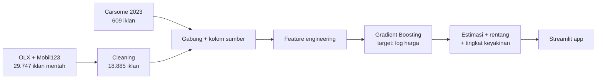

<div align="center">

# 🚗 Prediksi Harga Mobil Bekas Indonesia

**Isi spesifikasi mobil → dapatkan estimasi harga, rentang wajar, dan tingkat keyakinan model.**

[](https://www.python.org/)
[](https://scikit-learn.org/)
[](https://streamlit.io/)
[](#-data)

### [▶ Coba demo langsung](https://GANTI-DENGAN-LINK-APP.streamlit.app)

</div>

<!-- Tambahkan screenshot app di sini setelah deploy, misalnya:

-->

---

## 📌 Ringkasan

Banyak penjual mobil bekas menebak harga pasang dari perasaan, dan pembeli sulit menilai apakah harga iklan wajar. Project ini membangun model machine learning dari **19.472 iklan mobil bekas nyata** (OLX, Mobil123, Carsome) untuk menjawab dua pertanyaan:

- **Penjual:** berapa harga pasang yang pantas untuk mobil saya?
- **Pembeli:** apakah harga yang dipasang ini wajar, kemahalan, atau terlalu murah?

Yang membedakan project ini: model **jujur soal batas pengetahuannya**. Setiap estimasi datang dengan rentang harga dan tingkat keyakinan (Tinggi / Sedang / Rendah), dan untuk merek yang datanya tidak cukup, app menolak memberi angka daripada menebak asal.

> **English summary:** an end-to-end used-car price estimator for the Indonesian market. ~19.5k real listings → data cleaning → gradient boosting on log-price → calibrated price ranges with confidence levels → deployed Streamlit app (seller & buyer modes). Typical error ≈ 8% for well-covered models, with honest refusal for unsupported brands.

## ✨ Fitur app

| | |
|---|---|
| **Mode penjual** | Estimasi harga pasang, rentang wajar, tiga titik harga (cepat laku / seimbang / ruang tawar), dan grafik pola harga menurut tahun mobil |
| **Mode pembeli** | Masukkan harga iklan → vonis *di bawah / wajar / di atas* rentang, lengkap dengan posisi pada grafik dan titik tawar |
| **Tingkat keyakinan** | Tinggi (model punya ≥ 30 iklan), Sedang (8–29), Rendah (model jarang atau merek berdata sedikit) |
| **Penolakan jujur** | Merek di luar data (BMW, Hyundai, Kia, dll) tidak diberi angka |
| **Validasi input** | Peringatan untuk kilometer tidak wajar atau kapasitas mesin yang tidak cocok |
| **Contoh cepat** | Tombol untuk mencoba Avanza, Brio, Xpander, BYD Atto 3, atau Mercedes C-Class |

## 📊 Hasil

Diuji dengan validasi silang 5-lipat (iklan yang diuji tidak pernah dipakai melatih).

**Perbandingan model** (rata-rata meleset dari harga iklan):

| Model | Semua iklan | Km diketahui (situasi app) |
|---|---|---|
| Tebak median (pembanding) | 49,1% | 40,1% |
| Ridge (linear) | 14,3% | 11,6% |
| **Gradient Boosting** (dipilih) | **±10%** (31,3 juta Rp) | **7,9%** (22,1 juta Rp) |

**Seberapa jauh model bisa digeneralisasi:**

| Skenario | Rata-rata meleset | Median |
|---|---|---|
| Model sudah dikenal, km diisi | **7,9%** (22,1 juta) | 5,6% |
| Model sudah dikenal, semua iklan | ≈10% (31,3 juta) | 6,5% |
| Model **belum pernah dilihat**, km diisi | 19,4% (56,5 juta) | 14,7% |
| Model **belum pernah dilihat**, semua iklan | 22,7% (75,4 juta) | 16,6% |

Artinya: estimasi akurat untuk mobil populer, tetapi kasar untuk model yang jarang. Karena itu app memberi **rentang yang lebih lebar dan label keyakinan lebih rendah** saat datanya sedikit.

**Rentang harga** dikalibrasi dari sisa error validasi silang, per tingkat keyakinan, sehingga mencakup sekitar 80% harga iklan:

| Keyakinan | Rentang terhadap estimasi |
|---|---|
| Tinggi | ×0,87 sampai ×1,14 |
| Sedang | ×0,76 sampai ×1,28 |
| Rendah | ×0,64 sampai ×1,66 |

**Faktor paling berpengaruh** (permutation importance): model/tipe mobil dan umur mobil jauh di atas fitur lain.

> Catatan jujur: angka akurasi sedikit optimistis, karena iklan mobil yang mirip (unit sama, varian beda) bisa muncul di data latih dan data uji sekaligus. Anggap angka di atas sebagai batas atas kinerja, bukan jaminan.

## 💡 Insight bisnis

Selain memprediksi, project ini menganalisis **apa yang menentukan harga mobil bekas** (notebook `03_insight_bisnis.ipynb`). Perbandingan dilakukan di dalam model mobil yang sama (efek tetap per model), pada 18.884 iklan marketplace.

| Pertanyaan | Temuan |
|---|---|
| Seberapa cepat harga turun? | **±24% dalam 5 tahun pertama dan ±48% dalam 10 tahun.** Penurunan ±6-9% per tahun sampai umur 12, lalu makin curam (11-14% per tahun) |
| Merek mana yang paling tahan harga? | Median laju turun per tahun: Daihatsu ±3,6%, Honda ±6,1%, Toyota ±6,8%, **Mercedes-Benz ±12,2%**. Dalam rupiah (umur 5 tahun): Avanza ±Rp 12 juta per tahun, **C-Class ±Rp 69 juta** |
| Umur atau kilometer? | **Umur jauh lebih penting.** Setelah umur dikontrol, +10.000 km hanya menurunkan harga ±0,9%; penalti baru terasa di atas ±80 rb km (±7%) |
| Berapa premium varian? | Automatic **±+7%**, diesel **+11% sampai +27%** (Fortuner, Innova), hybrid penuh **±+25%** tetapi mild hybrid hanya **±+3%** |
| Apakah EV bekas cepat turun? | **Tidak terbukti.** Umur 1-4 tahun: listrik ±5,0% per tahun vs bensin ±5,1% |
| Di mana harga paling beragam? | Mercedes-Benz (sebaran ±30%), dua kali merek lain (±12-17%), sehingga butuh rentang harga, bukan angka tunggal |

> Semua angka adalah asosiasi pada **harga iklan**, bukan sebab-akibat dan bukan harga transaksi. Keterbatasan lengkap ada di notebook.

## 🗂️ Data

| Sumber | Isi | Lisensi |
|---|---|---|
| **Zenodo** — Thania, I. & Oktavia, T. (2026), DOI [10.5281/zenodo.21792616](https://doi.org/10.5281/zenodo.21792616) | Iklan OLX + Mobil123, Jabodetabek, 2025–2026, 29.747 baris mentah | CC BY 4.0 |
| **Kaggle** — *Used Car Listings in Indonesia* | Iklan carsome.id, 2023, 609 baris | CC0 |

Alur data: 29.747 baris mentah → **18.885 baris bersih** (Zenodo) + 599 baris Carsome (merek ≥ 15 iklan) = **19.472 baris** untuk model.

## 🔬 Metodologi



**Keputusan teknis yang penting:**

- **Cleaning:** header ikut ter-scrape, nama merek tidak seragam, baris kolom bergeser, harga/tahun tidak valid, dan **iklan kembar** (mobil sama dipasang di banyak kota) dibuang supaya tidak bocor antara data latih dan uji. Dari 29.747 baris tersisa 18.885.
- **Kilometer:** di data berbentuk rentang (mis. `10 - 15K km`), diambil titik tengahnya. Hanya sekitar separuh iklan mencantumkan km, sehingga model dilatih dengan nilai kosong apa adanya dan akurasinya dilaporkan terpisah.
- **Target log harga:** harga condong ke kanan (Rp 80 juta sampai lebih dari Rp 1 miliar).
- **Fitur:** merek, model (model jarang digabung jadi `LAINNYA`), umur, km, kapasitas mesin, bahan bakar, tipe bodi, transmisi, dan platform sumber.
- **Menggabung Carsome:** diuji, bukan diasumsikan. Akurasi di data utama tidak berubah (10,2% → 10,2%), dan di data Carsome membaik (7,0% → 6,0%). Nissan dan Mazda jadi bisa diberi estimasi, dengan keyakinan Rendah.
- **Menolak merek asing:** uji awal menahan seluruh satu merek dari data latih menghasilkan error 21% sampai 83%, terlalu besar untuk dipercaya, sehingga merek tanpa data cukup ditolak.
- **Versi 1 sebagai baseline:** notebook Carsome (609 baris) menunjukkan model linear sederhana menang di data kecil. Di data gabungan yang beragam, Gradient Boosting menang jelas.

## ⚠️ Batasan

- Harga yang dipakai adalah **harga iklan**, bukan harga transaksi akhir.
- Data utama hanya **Jabodetabek** dan merek tertentu (Honda, Toyota, Daihatsu, Suzuki, Mercedes-Benz, Mitsubishi, Wuling, BYD; Nissan dan Mazda dengan data sedikit).
- Kondisi fisik, riwayat servis, dan kelengkapan surat **tidak** dihitung.
- Harga 2025–2026 dan Carsome 2023 dicampur tanpa penyesuaian inflasi; platform dibedakan lewat fitur `sumber`.
- Model belum pernah melihat mobil yang sangat jarang, jadi estimasinya kasar (ditandai keyakinan Rendah).

## 📁 Struktur repo

```
Used-car-price-prediction/
├── app/
│   └── app.py                      # aplikasi Streamlit
├── data/
│   ├── dataset_raw_29747.csv       # data Zenodo (OLX + Mobil123)
│   └── used_car.csv                # data Carsome (Kaggle)
├── models/
│   └── model_v2.joblib             # model terlatih + metadata untuk app
├── notebook/
│   ├── 01_carsome.ipynb            # Versi 1: baseline di data Carsome
│   ├── 02_zenodo_model.ipynb       # Versi 2: data gabungan, model final
│   ├── 03_insight_bisnis.ipynb     # Insight bisnis: penyusutan, premium varian, EV vs bensin
│   ├── clean_zenodo.py             # pembersih data Zenodo
│   └── clean_carsome.py            # pemuat data Carsome
├── .streamlit/config.toml          # tema app
├── requirements.txt
└── README.md
```

## 🚀 Menjalankan di komputer sendiri

```bash
git clone https://github.com/USERNAME/Used-car-price-prediction.git
cd Used-car-price-prediction

python -m venv .venv
.venv\Scripts\activate            # Windows  (macOS/Linux: source .venv/bin/activate)
pip install -r requirements.txt
pip install jupyter matplotlib seaborn   # hanya untuk menjalankan notebook
```

1. Jalankan `notebook/02_zenodo_model.ipynb` dari atas sampai bawah (membuat `models/model_v2.joblib`).
   Model sudah disertakan di repo, jadi langkah ini opsional kalau hanya ingin mencoba app.
2. Jalankan app dari folder paling luar:

```bash
streamlit run app/app.py
```

> Model yang tersimpan peka terhadap versi library. Pakai versi yang sama dengan `requirements.txt`.

## ☁️ Deploy

App di-deploy di [Streamlit Community Cloud](https://streamlit.io/cloud) langsung dari repo ini: main file `app/app.py`, dependensi dari `requirements.txt`, tema dari `.streamlit/config.toml`.

## 🗺️ Rencana pengembangan

- [x] Insight bisnis (notebook 03): laju penurunan harga, merek/model paling tahan harga, premium varian, mobil listrik vs bensin
- [ ] Insight lanjutan: waktu terjual dan strategi harga (butuh data tanggal terjual)
- [ ] Tambah merek (Hyundai, Kia, BMW, dll) lewat data iklan baru
- [ ] Normalisasi nama model (mis. `Gran max` vs `Gran Max`) di tahap cleaning
- [ ] Penyesuaian inflasi / indeks waktu untuk menggabung data lintas tahun
- [ ] Fitur opsional harga mobil baru untuk membantu merek berdata sedikit

## 🙏 Kredit

- Dataset iklan OLX + Mobil123: **Thania, I. & Oktavia, T. (2026)**, Binus University, Zenodo, DOI [10.5281/zenodo.21792616](https://doi.org/10.5281/zenodo.21792616), lisensi CC BY 4.0.
- Dataset Carsome: *Used Car Listings in Indonesia*, Kaggle, lisensi CC0, data dari carsome.id (2023).
- Dibangun dengan Python, pandas, scikit-learn, dan Streamlit.

---

<div align="center">

Dibuat sebagai project portofolio data science · [GitHub](https://github.com/USERNAME) · [Portofolio](https://GANTI-DENGAN-LINK-PORTOFOLIO)

</div>
